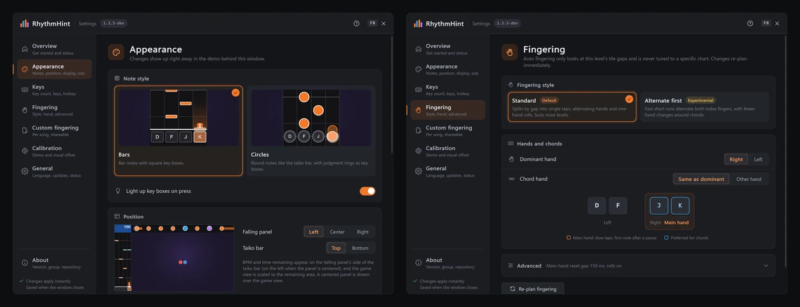

# RhythmHint

**A rhythm-game style hint panel for A Dance of Fire and Ice**

[简体中文](README.md) | [繁體中文](README.zh-Hant.md) | English | [한국어](README.ko.md) | [日本語](README.ja.md)

 

In A Dance of Fire and Ice any key counts, but once the rhythm gets messy, watching the planets spin just isn't enough to read what's coming.

So I made this mod: it turns every level's tiles into falling notes, so you can see what to press next, just like in a rhythm game. It only shows hints and never touches judgment, so your results work exactly as before.

> [!WARNING]
> Not touching judgment doesn't make it welcome everywhere: some communities and competitions treat key hints like this as cheating. Use it only for solo practice. Keep it off in multiplayer (e.g. Together, which blocks it outright), leaderboards and clear verification (e.g. TUF), and competitions. If you post a video or a score, say you had it on, and don't rename it to get past detection. Each place's own rules come first; when in doubt, leave it off.

## What it looks like

- **Falling lanes** (four, or six or eight on hard charts; see 6K / 8K below): one note for every tile you need to press. Orange for single notes, blue for doubles, purple for triples and quads, and holds get a tail. Notes can be bars or round notes like the ones on the taiko bar
- **Key boxes at the bottom**: light up when you press D F J K; the keys can be changed
- **Taiko bar**: a long stretch of the upcoming rhythm at a glance; purple triples and quads are marked 3 and 4
- **Lane side of the taiko bar**: current BPM, time left, and a difficulty estimated from the level's tiles (experimental)
- **Fit game view beside panel**: the game view and its UI text (combo, judgments, pause menu) shrink into the space next to the panel, so nothing is covered

The falling panel can sit on the left or the right, and the taiko bar at the top or the bottom; the game view moves out of the way.

The panel slides in when a level starts and out when it ends. It also hides when you pause with Esc, so it never covers the pause menu, and it freezes when you die and continues when you restart. Works with official levels, custom levels, and editor playtests and autoplay.

## Settings

Press **F8** in game (the hotkey can be changed).

Outside a level, a demo that follows the menu music plays next to the settings window, so you see every change right away.

| Page | What it's for |
|---|---|
| Overview | Current status, a few display switches, and shortcuts to Appearance, Fingering and Custom fingering |
| Appearance | Note style (bars / circles), panel position, which parts to show, size, opacity |
| Keys | Key count (chosen by difficulty, or pick 4K / 6K / 8K), the keys for each key count, the hotkey that opens the settings |
| Fingering | Fingering style, dominant hand, chord hand; rolls and thresholds are under Advanced |
| Custom fingering | Make your own fingering for this song, open the fingering folder |
| Calibration | Visual offset: adjust here if notes and music don't line up |
| General | Interface language, automatic updates and update progress (downloading, retry if it fails), status |
| About | Version, author, player group, repository |

A short guide walks you through it the first time; click the question mark in the top right to see it again. The window can be dragged and saves when closed, and clicking around in it never triggers the game.

The interface comes in 简体中文, 繁體中文, English, 한국어 and 日本語, and follows the game's language by default.

## How keys are assigned

No external charts are read. Each level only looks at the gaps between its own tiles and follows the habits of most ADOFAI players:

- Slow (more than 130 ms apart): **tap with the right index finger, J**
- A bit faster: **J F, alternating index fingers**
- Very fast (within 65 ms): two fingers of one hand take turns, **K J D F**
- After a pause it always starts again from the **right hand**
- Doubles go to the **right hand, J K**, when possible; single notes right next to a double go to the **left hand**. A double is never split across hands
- The same hand never goes index finger first, then outer finger (F→D, J→K); rolls always start with the outer finger
- The same key is never pressed twice within 150 ms

These thresholds follow how a strong player actually plays: we went through a perfect clear of Avantgarde frame by frame. Fast sections at 75 ms per note alternate both index fingers, while bursts around 50 ms still roll.

Triples and quads are recognized too (purple): for a triple, the chord hand presses two keys and the other hand's index finger adds one; a quad uses all four keys. Which tiles count as pressed together depends on how far the path turns between them: tiles the creator drew bunched together form a chord, while fast streams that just have a very high BPM are not mistaken for doubles. The purple tiles in the game's own RJ-X that need two keystrokes at once are shown as doubles too; if you set Multitap Tile Behavior to Hit Once in the game's settings, they're shown as singles.

On the Fingering page you can also:

- **Change the fingering style**: the default, Standard, is the set of rules above; Alternate first (experimental) alternates both index fingers on fast short runs of four or five notes, with fewer hand changes around chords. You can switch back at any time
- **Play left-handed**: set the dominant hand to left to mirror everything, with left F as the main key and rolls as D F K J
- **Put chords on the other hand**: for example, single notes on right J and doubles on left D F, with single notes next to a double moving to the right hand
- **Adjust the thresholds and rolls** under Advanced if something doesn't feel right

## 6K / 8K (experimental)

Besides 4K (D F J K) there are 6K (S D F J K L) and 8K (A S D F J K L ;). By default the key count is chosen from the estimated difficulty: P tiers stay 4K, 6K from G1, 8K from U6. When a custom fingering is in use, it is shown with its own key count.

- **Slow notes on the right index finger, medium ones alternating the two index fingers**, as easy to pick up as 4K
- **Fast runs roll across both hands**: the run is split between the hands, each hand rolling from the outside in to the index finger. Three or four notes use two fingers per hand, longer runs the whole hand: **L K J S D F** in 6K, **; L K J A S D F** in 8K
- **Chords stay on one hand when it has the fingers**: triples in 6K and quads in 8K are played with one hand
- **A finger that has no time to rest is swapped out**: for example, if the same key would come again right after a double, a rested finger takes it

If you'd rather not have it chosen for you, pick 4K / 6K / 8K under Key count on the Keys page, or change the tiers where 6K and 8K start under Tier thresholds. The keys for each key count are set on the Keys page too.

## Custom fingering

If the automatic fingering doesn't suit you, make your own for a song, or use one someone shared.

1. In the song (before starting or while paused is fine), press F8 → Custom fingering → Edit this level's fingering. The fingering editor opens in your browser with the level's tiles, music and both auto styles
2. Drag notes to other lanes, or select them and press D F J K. Click Save to game when you're done, and the game switches over right away
3. Fingering files live in `Mods/RhythmHint/Fingerings`. Send one to a friend and they just drop it into the same folder. The mod keeps a backup in `Documents\RhythmHint\FingeringsBackup` and restores your fingerings if UMM uninstalls or reverts the mod
4. Can't finish in one go? Just close the page; your changes are kept. To open the editor without the game, bookmark the page or click Create desktop shortcut on the Custom fingering page. History on the editor's left bar lists recent levels; click one to pick up where you left off

Once a file is in the folder there's nothing else to do: it's used automatically for its song. If the chart gets updated, the parts that still match keep your fingering, the rest use auto fingering, and you get a notice when the level starts. If several files look like the same song, the Custom fingering page lists them so you pick once. Details: [custom fingering guide](docs/专属手序.md) (in Chinese).

## Estimated difficulty (experimental)

In a level, the left half of the BPM box shows a TUF-style difficulty tier (P1–U20) estimated only from the tiles you press in that level. It works for official levels and workshop charts alike.

It's only an estimate, **not an official TUF rating**: most P-tier charts are within 1–2 tiers, G and U tiers are often 3–4 tiers off, and U-tier charts that need many keys tend to be rated too low. You can turn it off on the Appearance page. Method and accuracy: [difficulty estimate notes](docs/难度估算.md) (in Chinese).

## Installation

1. Install [Unity Mod Manager](https://www.nexusmods.com/site/mods/21) (0.27 or later, using the DoorstopProxy method)
2. Download `RhythmHint-<version>.zip` from [Releases](https://github.com/xiaoming6680/ADOFAI-RhythmHint/releases), then click **Install Mod** on the Mods tab of the UMM installer and choose it (or just drag the zip into the window)
   - You can also unzip it by hand and put the `RhythmHint` folder into `<game folder>\Mods\`
3. Start the game and press `Ctrl+F10` to check that it is enabled

From 1.3.1 on, the mod updates itself: when the game starts it checks for a new version, downloads and installs it in the background, and the update takes effect the next time you start the game; your settings are kept (you can turn this off on the General page). If GitHub can't be reached, it downloads through mirror sites in mainland China instead (1.3.2 and earlier only use GitHub). If the download still fails, right-click the mod on the Mods tab of the UMM installer and choose **Update**, or install the new `RhythmHint-<version>.zip`; there's no need to reinstall UMM. See the [changelog](CHANGELOG.en.md) for what changed in each version.

To build it yourself, see the [development notes](docs/开发说明.md) (in Chinese).

## Troubleshooting

- **No hints showing**: F8 → Status on the General page tells you why; the UMM log `Managed\UnityModManager\Log.txt` has it too
- **Not using D F J K**: under Key boxes on the Keys page, pick the 4K, 6K or 8K layout to edit, then click Custom and pick your own keys on the on-screen keyboard (Shift, Space, arrow keys, the numpad, F1–F12 and mouse side buttons all work). The hotkey that opens the settings is on the Keys page too
- **Notes and music don't line up**: adjust Visual offset on the Calibration page until notes land right on the beat
- **Does it affect my results?** No, judgment is not touched at all

## Credits

- Inspired by, and technically based on, the video [《【冰与火之舞·全节奏提示】CE-TX Dramatic Entrance!》](https://www.bilibili.com/video/BV17Agv6sEug) by Bilibili creator **Winkle雪线**. Thank you!
- The Alternate first fingering style was contributed by [Linxi-1105](https://github.com/Linxi-1105)
- Built on [Unity Mod Manager](https://www.nexusmods.com/site/mods/21)
- Difficulty icons from [The Universal Forums Assets](https://github.com/T21C/T21C-assets) (`pguDiff/`, © 2022-2024 the Universal Forums, [CC BY 4.0](https://creativecommons.org/licenses/by/4.0/)), scaled from 800×800 to 192×192. Using these icons does not mean TUF endorses this mod
- In-game screenshots are from the official level CI-X "REINCARNA✝ION!! ~Idol Graduation~" (7th Beat Games), music *REINCARNA✝ION!! Idol Graduation* by Turbo ft. Moon Jelly; the editor screenshot is from the official level XO-X (7th Beat Games)

## License

The code is open source under [MIT](LICENSE). The difficulty icons are used under CC BY 4.0 (see above). The level visuals and music in the screenshots belong to their original creators.
