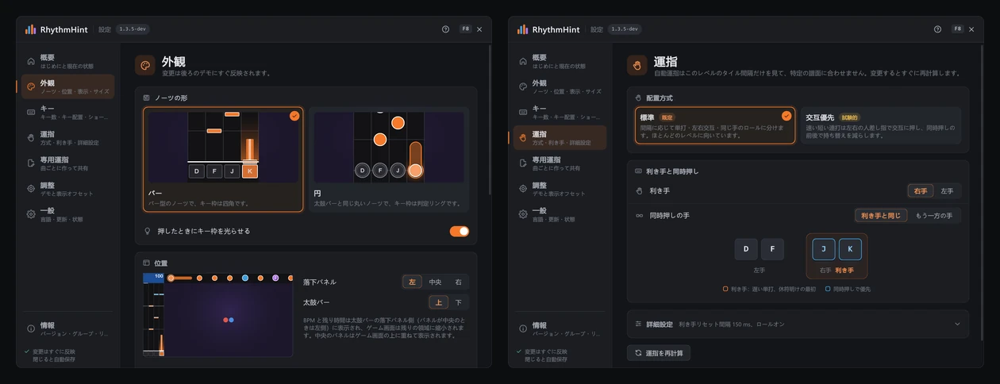

# RhythmHint

**A Dance of Fire and Ice に音ゲー風のガイドパネルを追加する Mod**

[简体中文](README.md) | [繁體中文](README.zh-Hant.md) | [English](README.en.md) | [한국어](README.ko.md) | 日本語

 

A Dance of Fire and Ice はどのキーを押してもいいゲームですが、リズムが崩れてくると、惑星の回転を見ているだけでは次の拍が読めなくなります。

そこでこの Mod を作りました。レベルのタイルを落ちてくるノーツに変えて、音ゲーのように次に押すものを先に見られるようにします。表示するだけで判定には一切触れないので、記録は元のままです。

> [!WARNING]
> 判定に触れないからといって、どこでも使っていいわけではありません。こうしたキー表示を不正行為とみなすコミュニティや大会もあります。一人で練習するときだけ使い、マルチプレイ（例：Together。検出されて弾かれます）、ランキングやクリア認定（例：TUF）、大会ではオフにしてください。動画や記録を公開するときは使っていたことを明記し、名前を変えて検出を逃れるようなことはしないでください。ルールは各コミュニティの規定が優先です。迷ったらオフにしてください。

## 画面の見かた

- **落下レーン**（4 本、難しい譜面では 6 本か 8 本。下の 6K / 8K を参照）：押すタイルごとにノーツが 1 つ出ます。オレンジは単押し、青は 2 点同時押し、紫は 3 点・4 点同時押しで、ホールドには尾が付きます。ノーツはバーにも、太鼓バーと同じ丸い形にもできます
- **下のキー枠**：D F J K を押すと光ります。キーは変更できます
- **太鼓バー**：この先のリズムを長めに見渡せます。紫の 3 点・4 点同時押しには 3、4 と表示されます
- **太鼓バーのレーン側の端**：現在の BPM、実際の BPM（実際に押す速さ。雪の結晶や直線で手の速さの目安になります）、残り時間、このレベルのタイルから推定した難易度（試験的）
- **ゲーム画面を自動調整**：ゲーム画面と UI の文字（コンボ、判定、ポーズメニュー）がパネルの外側に縮まるので隠れません

落下パネルは左か右、太鼓バーは上か下に置けて、ゲーム画面がよけてくれます。

レベルが始まるとパネルが入ってきて、終わると出ていきます。Esc でポーズしたときも格納されてポーズメニューを隠さず、ミスすると画面が止まり、リトライするとそのまま続きます。公式レベル、カスタムレベル、エディターのテストプレイとオートプレイに対応しています。

## 設定

ゲーム中に **F8** を押します（ショートカットキーは変更できます）。

レベルの外では、設定ウィンドウの横でメニュー音楽に合わせたデモが流れるので、何を変えてもすぐに確認できます。

| ページ | できること |
|---|---|
| 概要 | 現在の状態、いくつかの表示スイッチ、外観・運指・専用運指への入口 |
| 外観 | ノーツの形（バー / 円）、パネルの位置、表示する部分（判定表示も）、サイズ、不透明度 |
| キー | キー数（難易度で自動、または 4K / 6K / 8K を直接選ぶ）、キー数ごとのキー、設定を開くショートカットキー |
| 運指 | 配置方式、利き手、同時押しの手。ロールと境目は詳細設定にあります |
| 専用運指 | この曲の運指を自分で作る、運指フォルダーを開く |
| 調整 | 表示オフセット：ノーツと音楽が合わないときはここで調整 |
| 一般 | 表示言語、自動更新と更新の状況（ダウンロード中、失敗したら再試行）、動作状態 |
| 情報 | バージョン、作者、交流グループ、リポジトリ |

初めて開くと短いガイドが流れ、右上の？でもう一度見られます。ウィンドウはドラッグで動かせて、閉じると自動で保存されます。ウィンドウ内をクリックしてもゲームの入力にはなりません。

表示言語は简体中文、繁體中文、English、한국어、日本語 で、初期設定ではゲームの言語に合わせます。

## キーの割り振り方

外部の譜面は読みません。各レベルは自分のタイル同士の間隔だけを見て、多くの ADOFAI プレイヤーの癖に合わせて割り振ります。

- 遅いとき（間隔が 130 ms より長い）：**右手の人差し指 J で連打**
- 少し速いとき：**J F、左右の人差し指で交互に**
- とても速いとき（65 ms 以内）：片手の 2 本指で交互に、**K J D F**
- 休みのあとは必ず**右手**から
- 2 点同時押しはなるべく**右手の J K** に置き、そのすぐ隣の単押しは**左手**に回します。左右の手に 1 つずつ分かれた同時押しにはなりません
- 同じ手で人差し指のあとに外側の指（F→D、J→K）が来ることはなく、ロールは必ず外側の指から押します
- 同じキーを 150 ms 以内に 2 回押させることはありません

これらの境目は上手いプレイヤーの実際の押し方に合わせました。Avantgarde のパーフェクトクリア動画をコマ送りで見ると、1 打 75 ms の速い区間はすべて左右の人差し指の交互で、50 ms 前後の短い連打はロールでした。

3 点・4 点同時押しも認識します（紫）。3 点同時押しは同時押しの手が 2 キー、もう一方の手の人差し指が 1 キーを押し、4 点同時押しは 4 キーすべてを押します。どのタイルを同時に押すかは、道がどれだけ曲がるかで判断します。作者がひとかたまりに描いたタイルは同時押しになり、BPM がとても高いだけの速い連打は 2 点同時押しと間違えられません。ゲーム本編の RJ-X にある、同時に 2 回押す紫のタイルも 2 点同時押しとして表示します。ゲームの設定で「マルチタップタイルの動作」を「1回叩く」にすると単押しで表示します。

運指ページではさらに次のことができます。

- **配置方式を変える**：初期状態の「標準」が上のルールです。「交互優先」（試験的）は速い 4～5 音の短い連打を左右の人差し指で交互に押し、同時押しの前後で持ち替えを減らします。ほかにも試験的な方式が 2 つあります。「拍で手を分ける」は拍とタイルの入ってくる向きを見て、両手それぞれのリズムを保ちます。「右手で拍を刻む（強拍・弱拍）」は打鍵の間隔だけを見て、遅い連打は右手、密な連打は左右交互、付点のリズムは同じ時間単位でそろえます。いつでも戻せます
- **左利き**：利き手を左手にすると全体が左右反転し、左手の F が中心、ロールは D F K J になります
- **同時押しをもう一方の手に**：たとえば単押しは右手の J、2 点同時押しは左手の D F にして、同時押しのすぐ隣の単押しは右手に移します
- **境目やロールを調整**：詳細設定で、しっくりこなければ自分で調整できます

## 6K / 8K（試験的）

4K（D F J K）のほかに 6K（S D F J K L）と 8K（A S D F J K L ;）があります。初期設定では推定難易度で自動的に選びます：P 帯は 4K のまま、G1 から 6K、U6 から 8K。専用運指を使うときは、その運指のキー数で表示します。

- **遅いところは右手人差し指、中くらいの速さは左右の人差し指を交互に**：4K と同じく覚えやすい配置です
- **速い連打はまず片手でロール**：外側から内側の人差し指へ転がし、その手の指を一通り使い切ってから反対の手へ移ります。短い連打はなるべく真ん中をまたぎません。6K の 2 打は **K J**、3 打は **L K J**；長い連打は手ごと交互に：6K は **L K J S D F**、8K は **; L K J A S D F**
- **同時押しは指が足りれば片手で**：6K の 3 点、8K の 4 点同時押しは片手で押します
- **休む間のない指は替える**：たとえば同時押しの直後に同じキーがすぐまた来るときは、十分休んだ指に替えます

自動にしたくないときは、キーページの「キー数」で 4K / 6K / 8K を選ぶか、「難易度の境目」で 6K・8K を使い始める難易度を変えてください。キー数ごとのキーもキーページで設定します。

## 専用運指

自動の運指が手に合わなければ、曲ごとに自分の運指を作るか、共有された運指をそのまま使えます。

1. その曲に入って（開始前や一時停止中でも構いません）F8 → 専用運指 → このレベルの運指を編集 を押すと、ブラウザで運指エディターが開き、このレベルのタイル、音楽、2 種類の自動配置が読み込まれます
2. ノーツを別のレーンにドラッグするか、選択して D F J K を押します。終わったら「ゲームに保存」を押すと、ゲームにすぐ反映されます
3. 運指ファイルは `Mods/RhythmHint/Fingerings` にあります。ほかの人に送れば、同じフォルダーに入れるだけで使えます。Mod が `ドキュメント\RhythmHint\FingeringsBackup` に自動でバックアップするので、UMM でアンインストールや以前のバージョンへの戻しをしても運指は自動で復元されます
4. 一度で終わらなくてもページを閉じて大丈夫。変更は自動で残ります。ゲームなしでエディターを開くには、ページをブックマークするか、専用運指ページの「デスクトップにショートカットを作成」を押してください。エディター左の「履歴」に最近のレベルが並び、クリックすると続きから編集できます

フォルダーに入れておけば、あとは何もする必要はありません。対応する曲で自動的に使われます。譜面が更新されたら、一致する部分はそのまま、一致しない部分だけ自動運指になり、開始時にお知らせします。同じ曲のファイルが複数あって判断がつかないときは、専用運指ページで一度選ぶだけです。詳しくは[専用運指の説明](docs/专属手序.md)（中国語）をご覧ください。

## 推定難易度（試験的）

レベルに入ると、BPM 枠の左側に TUF 風の難易度ランク（P1–U20）が出ます。そのレベルで押すタイルだけから推定し、公式レベルにもワークショップの譜面にも対応します。

あくまで推定で、**TUF の公式評価ではありません**。P ランクの譜面はたいてい 1–2 ランク以内に収まりますが、G・U ランクは 3–4 ランクずれることが多く、たくさんのキーを使う U ランクの譜面は低めに出がちです。外観ページでオフにできます。方法と誤差は[難易度推定の説明](docs/难度估算.md)（中国語）をご覧ください。

## インストール

1. [Unity Mod Manager](https://www.nexusmods.com/site/mods/21) をインストールします（0.27 以上、DoorstopProxy 方式）
2. [Releases](https://github.com/xiaoming6680/ADOFAI-RhythmHint/releases) から `RhythmHint-<バージョン>.zip` をダウンロードし、UMM インストーラーの Mods タブで **Install Mod** を押して選びます（zip をウィンドウにドラッグしても OK）
   - 手動で解凍して、中の `RhythmHint` フォルダーを `ゲームフォルダー\Mods\` に入れても構いません
3. ゲームで `Ctrl+F10` を押し、有効になっているか確認します

1.3.1 からは自動で更新されます。ゲーム起動時に新しいバージョンを確認し、バックグラウンドでダウンロードしてインストール、次回の起動時に反映されます。設定もそのまま残ります（一般ページでオフにできます）。GitHub に接続できないときは、中国本土のミラーサイト経由で自動的にダウンロードします（1.3.2 以前は GitHub のみ）。それでもダウンロードできないときは、UMM インストーラーの Mods タブでこの Mod を右クリックして **Update** を選ぶか、新しい `RhythmHint-<バージョン>.zip` を入れてください。UMM の入れ直しは不要です。各バージョンの変更点は[更新履歴](CHANGELOG.en.md)（英語）にあります。

自分でビルドする場合は[開発メモ](docs/开发说明.md)（中国語）を参照してください。

## 困ったときは

- **ヒントが出ない**：F8 → 一般ページの動作状態に理由が出ます。UMM のログ `Managed\UnityModManager\Log.txt` にも残ります
- **D F J K を使わない**：キーページのキー枠で編集する 4K・6K・8K の配置を選んでから「カスタム」を押し、画面キーボードで自分のキーを選んでください（Shift、スペース、矢印キー、テンキー、F1–F12、マウスのサイドボタンも使えます）。設定を開くショートカットキーもキーページで変えます
- **ノーツと音楽が合わない**：調整ページの表示オフセットを、ノーツがちょうど拍に乗るまで調整してください
- **記録に影響はある？** ありません。判定にはまったく触れていません

## 謝辞

- アイデアと技術は Bilibili のクリエイター **Winkle雪线** さんの動画 [《【冰与火之舞·全节奏提示】CE-TX Dramatic Entrance!》](https://www.bilibili.com/video/BV17Agv6sEug) を参考にしました。ありがとうございます！
- 「交互優先」「拍で手を分ける」「右手で拍を刻む（強拍・弱拍）」の配置方式は [Linxi-1105](https://github.com/Linxi-1105) さんの貢献です
- [Unity Mod Manager](https://www.nexusmods.com/site/mods/21) を使用
- 難易度アイコンは [The Universal Forums Assets](https://github.com/T21C/T21C-assets)（`pguDiff/`、© 2022-2024 the Universal Forums、[CC BY 4.0](https://creativecommons.org/licenses/by/4.0/)）のものを 800×800 から 192×192 に縮小して使っています。これらのアイコンの使用は TUF がこの Mod を推奨していることを意味しません
- ゲーム画面のスクリーンショットは公式レベル CI-X「REINCARNA✝ION!! ～アイドル卒業～」（7th Beat Games）、楽曲 *REINCARNA✝ION!! Idol Graduation* by Turbo ft. Moon Jelly。エディターのスクリーンショットは公式レベル XO-X（7th Beat Games）

## ライセンス

コードは [MIT](LICENSE) で公開しています。難易度アイコンは CC BY 4.0 で使用しています（上記参照）。スクリーンショットに写っているレベル画面と音楽の著作権は原作者にあります。
