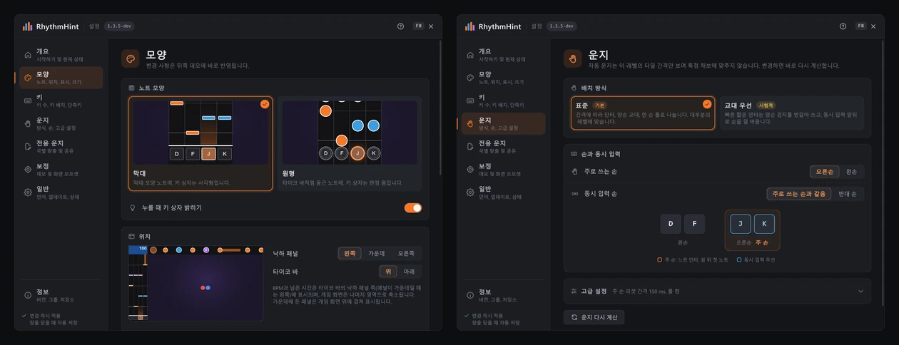

# RhythmHint

**얼불춤에 리듬게임식 안내 패널을 더해 주는 모드**

[简体中文](README.md) | [繁體中文](README.zh-Hant.md) | [English](README.en.md) | 한국어 | [日本語](README.ja.md)

 

얼음과 불의 춤은 아무 키나 눌러도 되지만, 리듬이 꼬이기 시작하면 행성이 도는 것만 봐서는 다음 박자를 읽기가 어렵습니다.

그래서 이 모드를 만들었습니다. 레벨의 타일을 떨어지는 노트로 바꿔서, 리듬게임처럼 다음에 무엇을 눌러야 할지 미리 볼 수 있게 해 줍니다. 보여 주기만 할 뿐 판정에는 손대지 않으니 기록은 원래 방식 그대로입니다.

> [!WARNING]
> 판정에 손대지 않는다고 어디서나 써도 되는 건 아닙니다. 이런 키 안내를 부정행위로 보는 커뮤니티와 대회도 있습니다. 혼자 연습할 때만 쓰고, 멀티플레이(예: Together, 바로 막힙니다), 순위표와 클리어 인증(예: TUF), 대회에서는 꺼 주세요. 영상이나 기록을 올릴 때는 켜 두었다고 밝히고, 이름을 바꿔 검사를 피하지 마세요. 규칙은 각 커뮤니티의 기준을 따르고, 애매하면 끄는 게 좋습니다.

## 화면 구성

- **낙하 레인**(4개, 어려운 채보는 6개나 8개. 아래 6K / 8K 참고): 눌러야 하는 타일마다 노트가 하나씩 나옵니다. 주황색은 단일 노트, 파란색은 2키 동시, 보라색은 3키·4키 동시이고, 홀드에는 꼬리가 붙습니다. 노트는 막대로도, 태고 바처럼 동그란 모양으로도 표시할 수 있습니다
- **아래쪽 키 상자**: D F J K를 누르면 불이 들어오고, 키는 바꿀 수 있습니다
- **태고 바**: 앞으로 나올 리듬을 길게 미리 볼 수 있습니다. 보라색 3키·4키 동시 노트에는 3, 4가 표시됩니다
- **태고 바의 레인 쪽 끝**: 현재 BPM, 남은 시간, 그리고 이 레벨의 타일로 추정한 난이도(시험적)
- **게임 화면 자동 맞춤**: 게임 화면과 UI 글자(콤보, 판정, 일시정지 메뉴)가 패널 바깥으로 줄어들어 가려지지 않습니다

낙하 패널은 왼쪽이나 오른쪽, 태고 바는 위나 아래에 둘 수 있고, 게임 화면이 알아서 비켜 줍니다.

레벨이 시작되면 패널이 들어오고 끝나면 나갑니다. Esc로 일시정지할 때도 접혀서 일시정지 메뉴를 가리지 않고, 죽으면 화면이 멈췄다가 다시 시작하면 이어집니다. 공식 레벨, 커스텀 레벨, 에디터 테스트 플레이와 자동 플레이 모두 지원합니다.

## 설정

게임 안에서 **F8**을 누르세요 (단축키는 바꿀 수 있습니다).

레벨 밖에서는 설정 창 옆에 메뉴 음악에 맞춘 데모가 재생되어, 무엇을 바꾸든 바로 확인할 수 있습니다.

| 페이지 | 하는 일 |
|---|---|
| 개요 | 현재 상태, 표시 스위치 몇 개, 모양·운지·전용 운지로 가는 입구 |
| 모양 | 노트 모양(막대 / 원형), 패널 위치, 표시할 항목, 키(4K·6K·8K 각각), 크기, 불투명도 |
| 운지 | 키 수, 배치 방식, 주로 쓰는 손, 동시 입력 손, 롤과 기준 간격 |
| 전용 운지 | 이 곡의 운지를 직접 만들기, 운지 폴더 열기 |
| 보정 | 화면 오프셋: 노트와 음악이 맞지 않을 때 여기서 조정 |
| 일반 | 인터페이스 언어, 설정 창을 여는 단축키, 자동 업데이트, 상태 |
| 정보 | 버전과 업데이트 진행 상황(다운로드 중, 실패하면 다시 시도), 제작자, 커뮤니티, 저장소 |

처음 열면 짧은 안내가 나오고, 오른쪽 위 물음표를 누르면 다시 볼 수 있습니다. 창은 끌어서 옮길 수 있고 닫을 때 자동으로 저장되며, 창 안을 클릭해도 게임에 입력되지 않습니다.

인터페이스는 简体中文, 繁體中文, English, 한국어, 日本語를 지원하며, 기본값은 게임 언어를 따릅니다.

## 키 배치 방식

외부 채보는 읽지 않습니다. 각 레벨은 자기 타일 사이의 간격만 보고, 대부분의 얼불춤 플레이어 습관에 맞춰 배치합니다.

- 느릴 때(130 ms보다 길 때): **오른손 검지 J로 연타**
- 조금 빠를 때: **J F, 양손 검지를 번갈아**
- 아주 빠를 때(65 ms 이내): 한 손의 두 손가락을 번갈아, **K J D F**
- 쉬었다가 다시 시작할 때는 항상 **오른손**부터
- 2키 동시는 되도록 **오른손 J K**에 두고, 바로 옆의 단일 노트는 **왼손**에 둡니다. 양손에 하나씩 나뉜 동시 입력은 나오지 않습니다
- 같은 손에서 검지 다음에 바깥 손가락(F→D, J→K)이 오지 않으며, 롤은 항상 바깥 손가락부터 누릅니다
- 같은 키를 150 ms 안에 두 번 누르게 하지 않습니다

이 기준 간격은 고수가 실제로 치는 방식을 따랐습니다. Avantgarde 퍼펙트 클리어 영상을 프레임 단위로 봤더니 75 ms 간격의 빠른 구간은 모두 양손 검지 교대였고, 50 ms 안팎의 짧은 연타는 그대로 롤이었습니다.

3키·4키 동시도 인식합니다(보라색). 3키 동시는 동시 입력 손이 키 두 개를, 반대 손 검지가 키 하나를 누르고, 4키 동시는 네 키를 모두 누릅니다. 어떤 타일을 동시에 누르는지는 경로가 얼마나 꺾이는지로 판단합니다. 제작자가 한데 모아 그린 타일은 동시 입력이 되고, BPM만 아주 높은 빠른 연타는 2키 동시로 잘못 묶이지 않습니다. 게임에 들어 있는 RJ-X의 보라색 타일처럼 한 번에 두 번 눌러야 하는 타일도 2키 동시로 표시하고, 게임 설정에서 다중 입력 타일 동작을 키 하나만 누르기로 바꾸면 단일 노트로 표시합니다.

운지 페이지에서는 이런 것도 할 수 있습니다.

- **배치 방식 바꾸기**: 기본값인 표준이 위의 규칙입니다. 교대 우선(시험적)은 빠른 4~5개 음의 짧은 연타를 양손 검지로 번갈아 치고, 동시 입력 앞뒤로 손을 덜 바꿉니다. 언제든 되돌릴 수 있습니다
- **왼손잡이**: 주로 쓰는 손을 왼손으로 바꾸면 전체가 좌우 반전되어, 왼손 F가 중심이 되고 롤은 D F K J가 됩니다
- **동시 입력을 반대 손에**: 예를 들어 단일 노트는 오른손 J, 2키 동시는 왼손 D F에 두고, 동시 입력 바로 옆의 단일 노트는 오른손으로 옮깁니다
- **기준 간격과 롤 조절**: 손에 맞지 않으면 직접 조정하세요

## 6K / 8K (시험적)

4K(D F J K) 말고도 6K(S D F J K L)와 8K(A S D F J K L ;)가 있습니다. 기본으로는 추정 난이도로 자동 선택합니다: P 등급은 그대로 4K, G1부터 6K, U6부터 8K. 전용 운지를 쓸 때는 그 운지의 키 수로 표시합니다.

- **느린 곳은 오른손 검지, 중간 속도는 양손 검지를 번갈아**: 4K처럼 쉽게 익힐 수 있습니다
- **빠른 연타는 양손이 번갈아 롤**: 연타를 양손에 나눠 손마다 바깥에서 안쪽 검지까지 굴립니다. 3–4타는 손마다 두 손가락, 더 길면 한 손 전체: 6K는 **L K J S D F**, 8K는 **; L K J A S D F**
- **동시 누르기는 손가락이 충분하면 한 손으로**: 6K의 3키, 8K의 4키 동시 누르기는 한 손으로 칩니다
- **쉴 틈이 없는 손가락은 바꿉니다**: 예를 들어 동시 누르기 직후 같은 키가 바로 또 나오면 충분히 쉰 손가락으로 바꿉니다

자동이 싫으면 운지 페이지의 키 수에서 4K / 6K / 8K를 고르거나, 6K·8K를 쓰기 시작하는 난이도를 바꾸세요. 키는 모양 페이지의 키 상자에서 키 수마다 설정합니다.

## 전용 운지

자동 운지가 손에 맞지 않으면 곡마다 자신만의 운지를 만들거나, 다른 사람이 공유한 운지를 그대로 쓸 수 있습니다.

1. 그 곡에 들어가서(시작 전이나 일시 정지 중이어도 됩니다) F8 → 전용 운지 → 이 레벨 운지 편집을 누르면 브라우저에서 운지 편집기가 열리고, 이 레벨의 타일, 음악, 두 가지 자동 배치가 함께 넘어갑니다
2. 노트를 다른 레인으로 끌거나, 선택한 뒤 D F J K를 누르세요. 다 고쳤으면 게임에 저장을 누르면 게임에 바로 적용됩니다
3. 운지 파일은 `Mods/RhythmHint/Fingerings`에 있습니다. 다른 사람에게 보내면 같은 폴더에 넣기만 하면 됩니다. 모드가 `문서\RhythmHint\FingeringsBackup`에 자동으로 백업해 두므로 UMM으로 제거하거나 이전 버전으로 되돌려도 운지가 자동으로 복원됩니다
4. 한 번에 다 못 고쳐도 페이지를 그냥 닫으면 됩니다. 수정 내용은 자동으로 남습니다. 게임 없이 편집기를 열려면 페이지를 즐겨찾기하거나 전용 운지 페이지에서 바탕 화면 바로 가기 만들기를 누르세요. 편집기 왼쪽의 기록에 최근 레벨이 있고, 누르면 이어서 고칠 수 있습니다

폴더에 넣어 두면 더 할 일이 없습니다. 해당 곡에 들어가면 자동으로 사용됩니다. 채보가 업데이트되면 맞는 부분은 그대로 쓰고, 맞지 않는 부분만 자동 운지로 바뀌며 시작할 때 알려 줍니다. 같은 곡 파일이 여러 개라 확실하지 않을 때는 전용 운지 페이지에서 한 번만 고르면 됩니다. 자세한 내용은 [전용 운지 설명](docs/专属手序.md)(중국어)을 참고하세요.

## 추정 난이도 (시험적)

레벨에 들어가면 BPM 상자 왼쪽에 TUF 스타일의 난이도 등급(P1–U20)이 나옵니다. 이 레벨에서 눌러야 하는 타일만 보고 추정하며, 공식 레벨과 창작마당 채보 모두 지원합니다.

어디까지나 추정이며 **TUF 공식 평가가 아닙니다**. P 등급 채보는 대부분 1–2등급 안쪽으로 맞지만 G·U 등급은 3–4등급씩 어긋나는 경우가 많고, 키를 많이 쓰는 U 등급 채보는 낮게 나오기 쉽습니다. 모양 페이지에서 끌 수 있습니다. 방법과 오차는 [난이도 추정 설명](docs/难度估算.md)(중국어)을 참고하세요.

## 설치

1. [Unity Mod Manager](https://www.nexusmods.com/site/mods/21)를 설치합니다 (0.27 이상, DoorstopProxy 방식)
2. [Releases](https://github.com/xiaoming6680/ADOFAI-RhythmHint/releases)에서 `RhythmHint-<버전>.zip`을 받아, UMM 설치 프로그램의 Mods 탭에서 **Install Mod**를 눌러 선택합니다 (압축 파일을 창에 끌어다 놓아도 됩니다)
   - 직접 압축을 풀어 `RhythmHint` 폴더를 `게임 폴더\Mods\`에 넣어도 됩니다
3. 게임에서 `Ctrl+F10`을 눌러 활성화되어 있는지 확인합니다

1.3.1부터는 자동으로 업데이트됩니다. 게임을 시작할 때 새 버전을 확인하고 백그라운드에서 내려받아 설치하며, 다음에 게임을 시작하면 적용되고 설정도 그대로 남습니다(일반 페이지에서 끌 수 있습니다). GitHub에 연결할 수 없으면 중국 본토의 미러 사이트를 거쳐 자동으로 내려받습니다(1.3.2 이하는 GitHub만 사용). 그래도 내려받지 못했을 때는 UMM 설치 프로그램의 Mods 탭에서 이 모드를 오른쪽 클릭해 **Update**를 고르거나, 새 `RhythmHint-<버전>.zip`을 설치하세요. UMM은 다시 설치하지 않아도 됩니다. 버전별 변경 내용은 [변경 기록](CHANGELOG.en.md)(영어)에 있습니다.

직접 빌드하려면 [개발 문서](docs/开发说明.md)(중국어)를 참고하세요.

## 문제 해결

- **안내가 나오지 않음**: F8 → 일반 페이지의 상태에 이유가 나옵니다. UMM 로그 `Managed\UnityModManager\Log.txt`에도 남습니다
- **D F J K를 쓰지 않음**: 모양 페이지의 키 상자에서 4K·6K·8K 중 하나를 고른 뒤 사용자 지정을 누르고 화면 키보드에서 자신의 키를 고르세요 (Shift, 스페이스, 방향키, 숫자 키패드, F1–F12, 마우스 사이드 버튼 모두 됩니다). 설정 창을 여는 단축키는 일반 페이지에서 바꿉니다
- **노트와 음악이 맞지 않음**: 보정 페이지에서 화면 오프셋을 노트가 정확히 박자에 닿을 때까지 조정하세요
- **기록에 영향이 있나요?** 없습니다. 판정은 전혀 건드리지 않습니다

## 감사의 말

- 아이디어와 기술은 Bilibili 크리에이터 **Winkle雪线**의 영상 [《【冰与火之舞·全节奏提示】CE-TX Dramatic Entrance!》](https://www.bilibili.com/video/BV17Agv6sEug)을 참고했습니다. 감사합니다!
- 교대 우선 배치 방식은 [Linxi-1105](https://github.com/Linxi-1105)님이 기여했습니다
- [Unity Mod Manager](https://www.nexusmods.com/site/mods/21) 기반
- 난이도 아이콘은 [The Universal Forums Assets](https://github.com/T21C/T21C-assets)(`pguDiff/`, © 2022-2024 the Universal Forums, [CC BY 4.0](https://creativecommons.org/licenses/by/4.0/))에서 가져와 800×800에서 192×192로 줄였습니다. 이 아이콘을 쓴다고 TUF가 이 모드를 보증하는 것은 아닙니다
- 게임 스크린샷은 공식 레벨 CI-X "REINCARNA✝ION!! ~아이돌 졸업~" (7th Beat Games), 곡 *REINCARNA✝ION!! Idol Graduation* by Turbo ft. Moon Jelly. 편집기 스크린샷은 공식 레벨 XO-X (7th Beat Games)

## 라이선스

코드는 [MIT](LICENSE)로 공개합니다. 난이도 아이콘은 CC BY 4.0으로 사용합니다(위 참고). 스크린샷 속 레벨 화면과 음악의 저작권은 원작자에게 있습니다.
