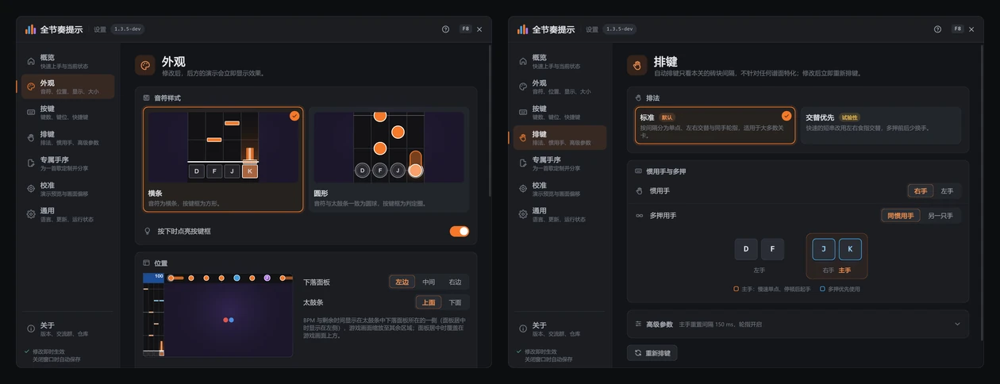

# 全节奏提示 RhythmHint

**给冰与火之舞加一块音游式的提示面板**

简体中文 | [繁體中文](README.zh-Hant.md) | [English](README.en.md) | [한국어](README.ko.md) | [日本語](README.ja.md)

 

冰与火之舞随便按哪个键都算，可节奏一乱，光盯着星球转圈根本读不过来。

所以我做了这个 Mod：把每一关的砖块变成下落式音符，像打音游一样提前看到接下来要按什么。它只负责「看」，不碰判定，成绩还是原来那套算法。

> [!WARNING]
> 不碰判定不等于哪都能开：有些社区和比赛会把这种按键提示当成作弊。请只在单人练习时用，联机（比如 Together，会直接拦下）、排行榜和成绩认证（比如 TUF）、比赛都别开；发视频、晒成绩记得说明开了它，也别改名去躲检测。各处规矩以对方的规定为准，拿不准就别开。

## 长什么样

- **下落轨道**（4 条，难谱是 6 条或 8 条，见下面的 6K / 8K）：每块要按的砖对应一个音符。橙色单押，蓝色双押，紫色三押、四押，长按带尾巴；音符可以是横条，也可以是和太鼓条一样的圆球
- **底下的按键框**：按 D F J K 会亮，键位可以换
- **太鼓条**：后面一长串节奏都能提前瞄到；三押、四押的紫色音符上写着 3、4
- **太鼓条靠轨道那一头**：当前 BPM、剩余时间，还有按这一关砖块估的难度（试验性）
- **自适应游戏画幅**：游戏画面和界面文字（连击数、判定、暂停菜单）自动缩到面板以外，不会被挡住

下落面板可以放左边或右边，太鼓条可以放上面或下面，游戏画面跟着让位。

开局面板滑进来，打完滑出去；按 Esc 暂停时也会收起，不挡暂停菜单；死了画面会停住，重开就接着走。官方关、自制关、编辑器里试玩和自动播放都能用。

## 设置

游戏里按 **F8**（快捷键可以换）。

不在关卡里的时候，设置窗口旁边会放一段跟着菜单音乐走的演示，改什么马上就能看到。

| 页 | 能做什么 |
|---|---|
| 概览 | 现在的状态、几个显示开关，还有去外观、排键、专属手序的入口 |
| 外观 | 音符样式（横条 / 圆形）、面板位置、显示哪些部分、键位（4K、6K、8K 各一套）、大小、透明度 |
| 排键 | 用几键、排法、惯用手、多押用手、轮指和分界线 |
| 专属手序 | 给这首歌做自己的手序、打开手序文件夹 |
| 校准 | 画面偏移：音符和音乐对不上就在这里调 |
| 通用 | 界面语言、打开设置的快捷键、自动更新、运行状态 |
| 关于 | 版本和更新进度（下载中、失败了可以重试）、作者、交流群、仓库 |

第一次打开会带你走一遍，右上角的问号可以再看。窗口可以拖，关掉自动保存，在窗口里点来点去不会误触游戏。

界面有简体中文、繁體中文、English、한국어、日本語，默认跟着游戏的语言走。

## 键是怎么排的

不读任何外部谱面，每关只看它自己砖块之间的间隔，按大多数冰与火玩家的习惯排：

- 慢的（两下隔 130 ms 以上）：**右手食指 J 连点**
- 快一些：**J F 左右食指轮流**
- 很快（65 ms 以内）：同一只手两根手指轮流，**K J D F**
- 停下来之后总是从**右手**开始
- 双押尽量放在**右手 J K**，紧挨着双押的单押放**左手**；不会出现一左一右的双押
- 同一只手不会先食指再外侧手指（F→D、J→K），轮指都是外侧手指先落
- 同一个键不会在 150 ms 内连按两次

这几条分界是照着高手实打定的：逐帧看了一个 Avantgarde 完美通关视频，75 ms 一下的快段都是两根食指交替，50 ms 左右的短串仍然轮指。

三押、四押也认得出来（紫色）：三押是按双押的那只手按两个键、另一只手食指补一个，四押四个键全按。哪些砖算同时按，看的是谱面上转了多大的角：谱师画成一团的就是多押，只是 BPM 很高的快连打不会被当成双押。游戏自带的 RJ-X 里那种要同时按两下的紫色方块也提示成双押；在游戏设置里把「多次按键方块行为」改成「按一次」，就按单押提示。

在「排键」页还可以：

- **换排法**：默认「标准」就是上面这套；「交替优先」（试验性）让快的四五个音的短串用左右食指交替，多押前后少换手。随时能切回
- **左撇子**：惯用手换成左手，整套左右镜像，左手 F 为主，轮指变成 D F K J
- **多押交给另一只手**：比如单押右手 J、双押左手 D F，紧挨着双押的单押改用右手
- **调分界线和轮指**：觉得不顺手就自己调

## 6K / 8K（试验性）

除了 4K（D F J K），还有 6K（S D F J K L）和 8K（A S D F J K L ;）。默认按估算难度自动选：P 档还是 4K，G1 起 6K，U6 起 8K；用上专属手序时，手序是几键就按几键显示。

- **慢的右手食指，中速左右食指轮流**，和 4K 一样好上手
- **快连打两只手轮流滚**：整串分给两只手，每只手一组从外往内滚到食指。三四下每只手两根手指，再长用满一只手：6K 是 **L K J S D F**，8K 是 **; L K J A S D F**
- **多押手指够就放一只手**：6K 三押、8K 四押都在一只手上
- **手指来不及歇就换一根**：比如刚按完双押、隔一下又要按同一个键，会换成一根歇够了的手指

不想要自动的话，在「排键」页「键数」里直接选 4K / 6K / 8K，或者改从哪一档起用 6K、8K。键位在「外观」页「按键框」里每种键数各设一套。

## 专属手序

觉得自动排的不顺手，可以给某首歌做一份自己的手序，或者直接用别人分享的。

1. 进到这首歌（还没开始、暂停也行），F8 →「专属手序」→「编辑本关手序」，浏览器会打开手序编辑器，这一关的砖块、音乐和两种自动排法都带过去了
2. 拖音符换轨，或者选中后直接按 D F J K；改完点「保存到游戏」，游戏里马上换上
3. 手序文件在 `Mods/RhythmHint/Fingerings` 里，发给别人，对方放进同一个文件夹就能用。Mod 会自动备份一份到 `文档\RhythmHint\FingeringsBackup`，用 UMM 卸载或回退版本后手序会自动还原
4. 一次改不完就直接关网页，改动会自动留着。不开游戏也能打开编辑器：收藏网页，或者在「专属手序」页点「创建桌面快捷方式」；编辑器左边的「历史」里有最近的关卡，点一下接着改

放进去就不用再管：进到对应的歌会自动用上。谱面更新过的话，对得上的地方照用，对不上的几段改用自动排键，开局会提醒。同一首歌放了好几份、认不准的时候，「专属手序」页会列出来让你选一次。细节见[专属手序说明](docs/专属手序.md)。

## 估算难度（试验性）

进关卡后，BPM 框左边会显示一个 TUF 风格的难度档位（P1–U20），只看这一关要按的砖估出来，官方关、创意工坊谱都能估。

这只是估算，**不是 TUF 的官方评级**：大多数 P 档谱差 1–2 档，G、U 档常差 3–4 档，要很多键的 U 档谱容易估低。不想看可以在「外观」页关掉。做法和误差见[难度估算说明](docs/难度估算.md)。

## 安装

1. 装好 [Unity Mod Manager](https://www.nexusmods.com/site/mods/21)（0.27 以上，选 DoorstopProxy 方式）
2. 去 [Releases](https://github.com/xiaoming6680/ADOFAI-RhythmHint/releases) 下载 `RhythmHint-版本号.zip`，在 UMM 安装器的 Mods 页点 **Install Mod** 选它（或直接把压缩包拖进窗口）
   - 也可以手动解压，把里面的 `RhythmHint` 文件夹放进 `游戏目录\Mods\`
3. 进游戏按 `Ctrl+F10` 确认它已启用

国内下载慢的话，[夸克网盘](https://pan.quark.cn/s/6ef42ac0c8dd?pwd=uxha)里有 UMM 和最新版 Mod，交流 Q 群 1136407588 的群文件里也有。

从 1.3.1 起会自动更新：启动游戏时检查新版本，在后台下载安装，重启游戏后生效，设置会保留（不想要可以在「通用」页关掉）。连不上 GitHub 时会自动改从国内加速镜像下载（1.3.2 及以前的版本只连 GitHub）。还是下载不了的话，在 UMM 安装器的 Mods 页右键本 Mod 选 **Update**，或者换新的 `RhythmHint-版本号.zip`，UMM 不用重装。每版改了什么见[更新记录](CHANGELOG.md)。

想自己编译看[开发说明](docs/开发说明.md)。

## 遇到问题

- **提示没出来**：F8 →「通用」页的「运行状态」会写原因，UMM 日志 `Managed\UnityModManager\Log.txt` 里也有
- **不用 D F J K**：「外观」页「按键框」里先选 4K、6K 还是 8K，再点「自定义」，在屏幕键盘上点出你自己的键（Shift、空格、方向键、小键盘、F1–F12、鼠标侧键都行）；打开设置的快捷键在「通用」页换
- **音符和音乐对不上**：「校准」页调「画面偏移」，调到音符正好踩在拍子上
- **会不会影响成绩**：不会，判定完全没动
- **反馈、交流**：QQ 群 1136407588（ADOFAI-RhythmHint）

## 致谢

- 灵感和技术参考来自 B 站 UP 主 **Winkle雪线** 的[《【冰与火之舞·全节奏提示】CE-TX Dramatic Entrance!》](https://www.bilibili.com/video/BV17Agv6sEug)，谢谢！
- 「交替优先」排法由 [Linxi-1105](https://github.com/Linxi-1105) 贡献
- 基于 [Unity Mod Manager](https://www.nexusmods.com/site/mods/21)
- 难度图标来自 [The Universal Forums Assets](https://github.com/T21C/T21C-assets)（`pguDiff/`，© 2022-2024 the Universal Forums，[CC BY 4.0](https://creativecommons.org/licenses/by/4.0/)），从 800×800 缩到 192×192；用这些图标不代表 TUF 认可本 Mod
- 实机截图来自官方关卡 CI-X《REINCARNA✝ION!! ～偶像毕业～》（7th Beat Games），乐曲 *REINCARNA✝ION!! Idol Graduation* by Turbo ft. Moon Jelly；编辑器截图来自官方关卡 XO-X（7th Beat Games）

## 许可证

代码用 [MIT](LICENSE) 开源。难度图标按 CC BY 4.0 使用（见上）。截图里的关卡画面和音乐版权归原作者。
