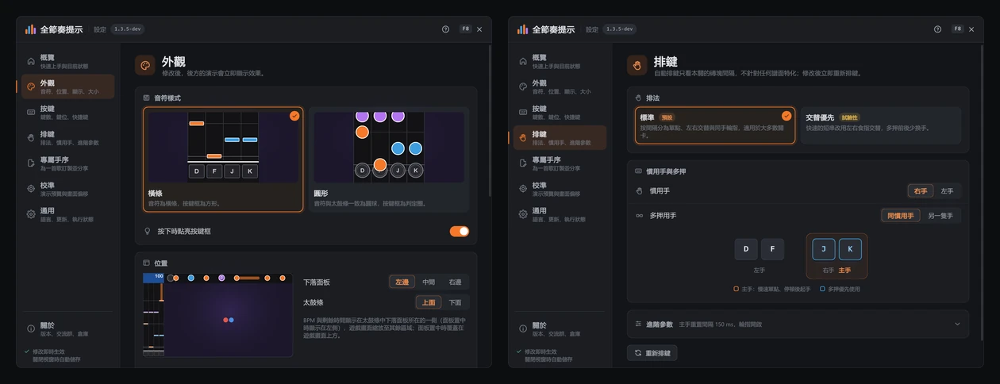

# 全節奏提示 RhythmHint

**給冰與火之舞加一塊音遊式的提示面板**

[简体中文](README.md) | 繁體中文 | [English](README.en.md) | [한국어](README.ko.md) | [日本語](README.ja.md)

 

冰與火之舞隨便按哪個鍵都算，可是節奏一亂，光盯著星球轉圈根本讀不過來。

所以我做了這個 Mod：把每一關的磚塊變成下落式音符，像打音遊一樣提前看到接下來要按什麼。它只負責「看」，不碰判定，成績還是原本那套算法。

> [!WARNING]
> 不碰判定不等於哪裡都能開：有些社群和比賽會把這種按鍵提示當成作弊。請只在單人練習時用，多人連線（例如 Together，會直接擋下）、排行榜和成績認證（例如 TUF）、比賽都別開；發影片、曬成績記得說明開了它，也別改名去躲偵測。各處規矩以對方的規定為準，拿不準就別開。

## 長什麼樣

- **下落軌道**（4 條，難譜是 6 條或 8 條，見下面的 6K / 8K）：每塊要按的磚對應一個音符。橘色單押，藍色雙押，紫色三押、四押，長按帶尾巴；音符可以是橫條，也可以是和太鼓條一樣的圓球
- **下面的按鍵框**：按 D F J K 會亮，鍵位可以換
- **太鼓條**：後面一長串節奏都能提前瞄到；三押、四押的紫色音符上寫著 3、4
- **太鼓條靠軌道那一頭**：目前 BPM、剩餘時間，還有按這一關磚塊估的難度（試驗性）
- **自適應遊戲畫幅**：遊戲畫面和介面文字（連擊數、判定、暫停選單）自動縮到面板以外，不會被擋住

下落面板可以放左邊或右邊，太鼓條可以放上面或下面，遊戲畫面跟著讓位。

開局面板滑進來，打完滑出去；按 Esc 暫停時也會收起，不擋暫停選單；死了畫面會停住，重開就接著走。官方關、自製關、編輯器裡試玩和自動播放都能用。

## 設定

遊戲裡按 **F8**（快捷鍵可以換）。

不在關卡裡的時候，設定視窗旁邊會放一段跟著選單音樂走的示範，改什麼馬上就能看到。

| 頁 | 能做什麼 |
|---|---|
| 概覽 | 現在的狀態、幾個顯示開關，還有去外觀、排鍵、專屬手序的入口 |
| 外觀 | 音符樣式（橫條 / 圓形）、面板位置、顯示哪些部分（包括判定提示）、大小、透明度 |
| 按鍵 | 用幾鍵（按難度自動，或直接選 4K / 6K / 8K）、每種鍵數的鍵位、開啟設定的快捷鍵 |
| 排鍵 | 排法、慣用手、多押用手，輪指和分界線收在「進階參數」裡 |
| 專屬手序 | 給這首歌做自己的手序、開啟手序資料夾 |
| 校準 | 畫面偏移：音符和音樂對不上就在這裡調 |
| 通用 | 介面語言、自動更新和更新進度（下載中、失敗了可以重試）、執行狀態 |
| 關於 | 版本、作者、交流群、倉庫 |

第一次開啟會帶你走一遍，右上角的問號可以再看。視窗可以拖曳，關掉自動儲存，在視窗裡點來點去不會誤觸遊戲。

介面有简体中文、繁體中文、English、한국어、日本語，預設跟著遊戲的語言走。

## 鍵是怎麼排的

不讀任何外部譜面，每關只看它自己磚塊之間的間隔，照大多數冰與火玩家的習慣排：

- 慢的（兩下隔 130 ms 以上）：**右手食指 J 連點**
- 快一些：**J F 左右食指輪流**
- 很快（65 ms 以內）：同一隻手兩根手指輪流，**K J D F**
- 停下來之後總是從**右手**開始
- 雙押盡量放在**右手 J K**，緊挨著雙押的單押放**左手**；不會出現一左一右的雙押
- 同一隻手不會先食指再外側手指（F→D、J→K），輪指都是外側手指先落
- 同一個鍵不會在 150 ms 內連按兩次

這幾條分界是照著高手實打定的：逐格看了一個 Avantgarde 完美通關影片，75 ms 一下的快段都是兩根食指交替，50 ms 左右的短串仍然輪指。

三押、四押也認得出來（紫色）：三押是按雙押的那隻手按兩個鍵、另一隻手食指補一個，四押四個鍵全按。哪些磚算同時按，看的是譜面上轉了多大的角：譜師畫成一團的就是多押，只是 BPM 很高的快連打不會被當成雙押。遊戲內建的 RJ-X 裡那種要同時按兩下的紫色格子也提示成雙押；在遊戲設定裡把「多次按鍵格子行為」改成「按一次」，就按單押提示。

在「排鍵」頁還可以：

- **換排法**：預設「標準」就是上面這套；「交替優先」（試驗性）讓快的四五個音的短串用左右食指交替，多押前後少換手。隨時能切回
- **左撇子**：慣用手換成左手，整套左右鏡像，左手 F 為主，輪指變成 D F K J
- **多押交給另一隻手**：比如單押右手 J、雙押左手 D F，緊挨著雙押的單押改用右手
- **調分界線和輪指**：在「進階參數」裡，覺得不順手就自己調

## 6K / 8K（試驗性）

除了 4K（D F J K），還有 6K（S D F J K L）和 8K（A S D F J K L ;）。預設依估算難度自動選：P 檔還是 4K，G1 起 6K，U6 起 8K；用上專屬手序時，手序是幾鍵就按幾鍵顯示。

- **慢的右手食指，中速左右食指輪流**，和 4K 一樣好上手
- **快連打兩隻手輪流滾**：整串分給兩隻手，每隻手一組從外往內滾到食指。三四下每隻手兩根手指，再長用滿一隻手：6K 是 **L K J S D F**，8K 是 **; L K J A S D F**
- **多押手指夠就放一隻手**：6K 三押、8K 四押都在一隻手上
- **手指來不及歇就換一根**：比如剛按完雙押、隔一下又要按同一個鍵，會換成一根歇夠了的手指

不想要自動的話，在「按鍵」頁「鍵數」裡直接選 4K / 6K / 8K，或者在「檔位分界」裡改從哪一檔起用 6K、8K。每種鍵數的鍵位也在「按鍵」頁各設一套。

## 專屬手序

覺得自動排的不順手，可以給某首歌做一份自己的手序，或者直接用別人分享的。

1. 進到這首歌（還沒開始、暫停也行），F8 →「專屬手序」→「編輯本關手序」，瀏覽器會開啟手序編輯器，這一關的磚塊、音樂和兩種自動排法都帶過去了
2. 拖曳音符換軌，或者選取後直接按 D F J K；改完點「儲存到遊戲」，遊戲裡馬上換上
3. 手序檔案在 `Mods/RhythmHint/Fingerings` 裡，傳給別人，對方放進同一個資料夾就能用。Mod 會自動備份一份到 `文件\RhythmHint\FingeringsBackup`，用 UMM 解除安裝或退回版本後手序會自動還原
4. 一次改不完就直接關網頁，改動會自動留著。不開遊戲也能開啟編輯器：收藏網頁，或在「專屬手序」頁點「建立桌面捷徑」；編輯器左邊的「歷史」裡有最近的關卡，點一下接著改

放進去就不用再管：進到對應的歌會自動用上。譜面更新過的話，對得上的地方照用，對不上的幾段改用自動排鍵，開局會提醒。同一首歌放了好幾份、認不準的時候，「專屬手序」頁會列出來讓你選一次。細節見[專屬手序說明](docs/专属手序.md)（簡體中文）。

## 估算難度（試驗性）

進關卡後，BPM 框左邊會顯示一個 TUF 風格的難度檔位（P1–U20），只看這一關要按的磚估出來，官方關、創意工坊譜都能估。

這只是估算，**不是 TUF 的官方評級**：大多數 P 檔譜差 1–2 檔，G、U 檔常差 3–4 檔，要很多鍵的 U 檔譜容易估低。不想看可以在「外觀」頁關掉。做法和誤差見[難度估算說明](docs/难度估算.md)（簡體中文）。

## 安裝

1. 裝好 [Unity Mod Manager](https://www.nexusmods.com/site/mods/21)（0.27 以上，選 DoorstopProxy 方式）
2. 到 [Releases](https://github.com/xiaoming6680/ADOFAI-RhythmHint/releases) 下載 `RhythmHint-版本號.zip`，在 UMM 安裝器的 Mods 頁點 **Install Mod** 選它（或直接把壓縮檔拖進視窗）
   - 也可以手動解壓縮，把裡面的 `RhythmHint` 資料夾放進 `遊戲目錄\Mods\`
3. 進遊戲按 `Ctrl+F10` 確認它已啟用

下載慢的話，[夸克網盤](https://pan.quark.cn/s/6ef42ac0c8dd?pwd=uxha)裡有 UMM 和最新版 Mod，交流 Q 群 1136407588 的群檔案裡也有。

從 1.3.1 起會自動更新：啟動遊戲時檢查新版本，在背景下載安裝，重新啟動遊戲後生效，設定會保留（不想要可以在「通用」頁關掉）。連不上 GitHub 時會自動改從中國大陸的加速鏡像下載（1.3.2 及以前的版本只連 GitHub）。還是下載不了的話，在 UMM 安裝器的 Mods 頁右鍵本 Mod 選 **Update**，或者換新的 `RhythmHint-版本號.zip`，UMM 不用重裝。每版改了什麼見[更新記錄](CHANGELOG.md)（簡體中文）。

想自己編譯看[開發說明](docs/开发说明.md)（簡體中文）。

## 遇到問題

- **提示沒出來**：F8 →「通用」頁的「執行狀態」會寫原因，UMM 記錄檔 `Managed\UnityModManager\Log.txt` 裡也有
- **不用 D F J K**：「按鍵」頁「按鍵框」裡先選要改 4K、6K 還是 8K，再點「自訂」，在螢幕鍵盤上點出你自己的鍵（Shift、空白鍵、方向鍵、數字鍵盤、F1–F12、滑鼠側鍵都行）；開啟設定的快捷鍵也在「按鍵」頁換
- **音符和音樂對不上**：「校準」頁調「畫面偏移」，調到音符正好踩在拍子上
- **會不會影響成績**：不會，判定完全沒動
- **回饋、交流**：QQ 群 1136407588（ADOFAI-RhythmHint）

## 致謝

- 靈感和技術參考來自 B 站 UP 主 **Winkle雪线** 的[《【冰与火之舞·全节奏提示】CE-TX Dramatic Entrance!》](https://www.bilibili.com/video/BV17Agv6sEug)，謝謝！
- 「交替優先」排法由 [Linxi-1105](https://github.com/Linxi-1105) 貢獻
- 基於 [Unity Mod Manager](https://www.nexusmods.com/site/mods/21)
- 難度圖示來自 [The Universal Forums Assets](https://github.com/T21C/T21C-assets)（`pguDiff/`，© 2022-2024 the Universal Forums，[CC BY 4.0](https://creativecommons.org/licenses/by/4.0/)），從 800×800 縮到 192×192；使用這些圖示不代表 TUF 認可本 Mod
- 實機截圖來自官方關卡 CI-X《REINCARNA✝ION!! ～偶像畢業～》（7th Beat Games），樂曲 *REINCARNA✝ION!! Idol Graduation* by Turbo ft. Moon Jelly；編輯器截圖來自官方關卡 XO-X（7th Beat Games）

## 授權

程式碼以 [MIT](LICENSE) 開源。難度圖示依 CC BY 4.0 使用（見上）。截圖裡的關卡畫面和音樂版權歸原作者。
